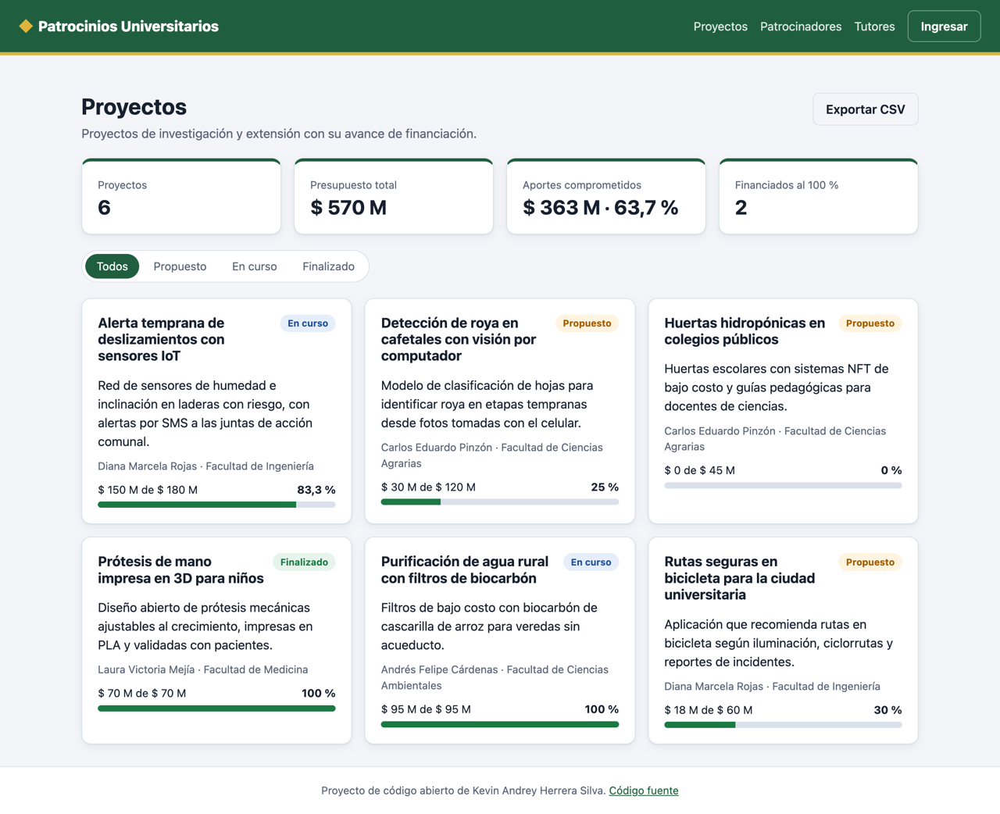
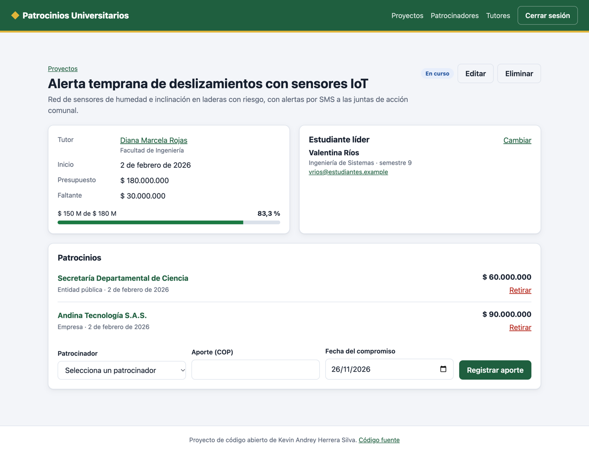

# Patrocinios Universitarios: gestión de financiación de proyectos de investigación (Ruby on Rails 8)

[](https://github.com/KevinAndrey96/rails-university-projects-sponsorship-manager/actions/workflows/ci.yml)


[](LICENSE)

**Patrocinios Universitarios** es una aplicación web para que una **universidad** gestione la **financiación de sus proyectos de investigación y extensión**: proyectos con su tutor y estudiante líder, **patrocinadores** (empresas, ONG, entidades públicas y otras universidades) y los **aportes comprometidos** por cada uno, con el avance de financiación en tiempo real.

Incluye catálogo público de proyectos, reporte CSV de financiación, API JSON abierta y gestión autenticada para la coordinación de investigación.



> Los datos de demostración son **ficticios**.

## Características

- **Avance de financiación** por proyecto: comprometido, faltante y porcentaje, calculados en una sola consulta.
- **Indicadores del portafolio**: presupuesto total, aportes comprometidos y proyectos financiados al 100 %.
- **Actualización en vivo** con Turbo Streams: al registrar o retirar un aporte, la página del proyecto se refresca en todos los navegadores abiertos.
- **Formularios en línea** con Hotwire: los errores de un aporte se muestran sin recargar la página.
- **Validación del NIT** de los patrocinadores con el dígito de verificación de la DIAN.
- **Teléfonos colombianos** normalizados al plan de numeración de 2021 (móviles `3XX` y fijos `60X`).
- **Exportación CSV** del estado de financiación, lista para hojas de cálculo.
- **API JSON** pública, paginada y con límite de solicitudes.
- **Protección de datos personales** (Ley 1581 de 2012): correos y teléfonos solo son visibles con sesión iniciada y nunca salen por la API.



## Modelo de dominio

| Modelo | Reglas |
| --- | --- |
| `Project` | Título único sin importar tildes ni mayúsculas, presupuesto positivo, estado `propuesto`, `en curso` o `finalizado` |
| `Tutor` | Docente con correo único; al eliminarlo sus proyectos quedan sin tutor |
| `StudentLead` | Un único estudiante líder por proyecto, semestre entre 1 y 12 |
| `Sponsor` | NIT único con dígito de verificación válido; no se elimina si tiene aportes |
| `Sponsorship` | Un aporte por patrocinador y proyecto, monto positivo |

Las reglas se refuerzan en la base de datos con índices únicos y restricciones `CHECK`.

## Arquitectura

| Capa | Implementación |
| --- | --- |
| Dominio | `Project`, `Tutor`, `StudentLead`, `Sponsor`, `Sponsorship`, `NitValidator` |
| Casos de uso | `FundingSummary` (indicadores), `FundingReport` (CSV), `Page` (paginación) |
| Web | Controladores públicos de lectura, recursos anidados `projects/` con sesión, `api/v1` sobre `ActionController::API` |
| Infraestructura | Rails 8.1, Solid Queue, Solid Cache, Solid Cable, Propshaft, importmap, Thruster |

## Inicio rápido con Docker

```bash
cp .env.example .env
# Completa SECRET_KEY_BASE (openssl rand -hex 64) y ADMIN_PASSWORD (mínimo 10 caracteres)
docker compose up --build
```

Abre <http://localhost:3000>. En el primer arranque se crea la base de datos, la cuenta de coordinación y se cargan 6 proyectos, 4 tutores y 6 patrocinadores de demostración (`LOAD_DEMO_DATA=true`).

## Desarrollo local

Requisitos: Ruby 3.4 y SQLite 3.

```bash
bundle install
ADMIN_PASSWORD=una-clave-segura bin/setup
bin/dev
```

## API JSON

Sin autenticación, 120 solicitudes por minuto por IP, paginación con `page` y `per_page` (25 por defecto).

```bash
curl "http://localhost:3000/api/v1/projects?status=in_progress"
curl http://localhost:3000/api/v1/projects/1
curl http://localhost:3000/api/v1/sponsors
```

```json
{
  "data": [{ "title": "Alerta temprana de deslizamientos con sensores IoT", "status": "in_progress",
             "budget": 180000000, "funded_amount": 150000000, "funding_ratio": 0.8333 }],
  "meta": { "page": 1, "per_page": 25, "total_count": 1, "total_pages": 1 }
}
```

## Calidad y seguridad

```bash
bin/rails test          # 57 pruebas de modelos, reportes, páginas públicas, gestión y API
bin/rubocop             # estilo rubocop-rails-omakase
bin/brakeman            # análisis estático de seguridad
bin/bundler-audit       # dependencias con vulnerabilidades conocidas
bin/smoke-test URL      # prueba de humo contra un contenedor en ejecución
```

El pipeline de GitHub Actions ejecuta Brakeman, bundler-audit, auditoría de importmap, RuboCop, la suite de pruebas y construye la imagen de producción para correr la prueba de humo.

Medidas aplicadas: Content Security Policy estricta con nonces, `frame-ancestors 'none'`, HTTPS forzado por defecto, sesiones con cookies firmadas `httponly`, límite de intentos de inicio de sesión, sin registro público, sin credenciales en el repositorio y secretos solo por variables de entorno.

## Historia del proyecto

El proyecto nació en agosto de 2017 como un andamiaje (scaffold) universitario en Rails 5.1 para relacionar proyectos, patrocinadores, encargados y tutores. Ese código se conserva en la etiqueta [`v0.1-rails-5.1-scaffold-2017`](https://github.com/KevinAndrey96/rails-university-projects-sponsorship-manager/tree/v0.1-rails-5.1-scaffold-2017). En 2026 se reescribió por completo sobre Rails 8.1 con el cálculo de financiación, Hotwire, la API y la exportación CSV.

## Licencia

[MIT](LICENSE) © 2017-2026 Kevin Andrey Herrera Silva
